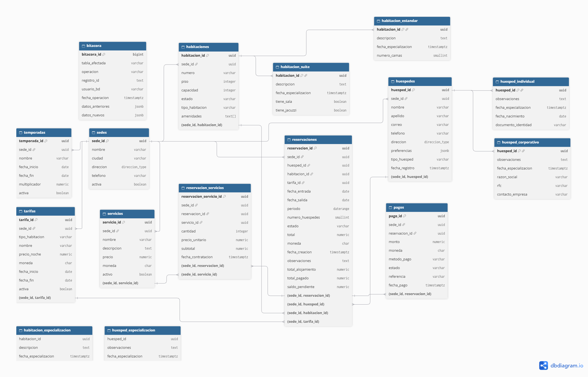
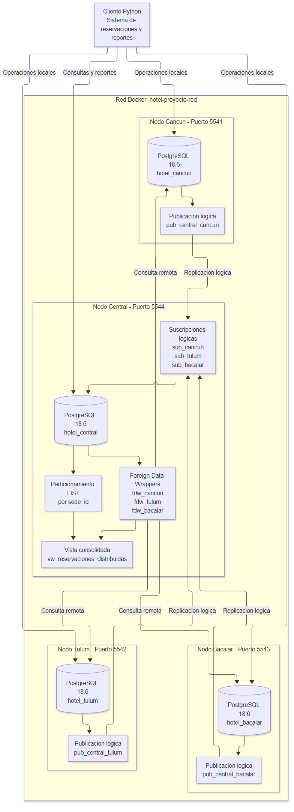

# BASE DE DATOS DISTRIBUIDA PARA RESERVACIONES DE UNA CADENA HOTELERA CON SEDES EN CANCÚN, TULUM Y BACALAR

## PORTADA

**Universidad Politécnica de Quintana Roo**

**Ingeniería en Software**

**Asignatura:** Bases de Datos

**Proyecto integrador:** Base de datos distribuida para reservaciones de una cadena hotelera con sedes en Cancún, Tulum y Bacalar.

**Presenta:** Alejandro Marron Palafox

**Matrícula:** 202300141

**Lugar:** Cancún, Quintana Roo, México.

**Fecha de entrega:** 26 de noviembre de 2026.

---

# 1. Introducción

La administración de reservaciones en una cadena hotelera requiere mantener información consistente y disponible entre sus diferentes establecimientos. Cuando cada sede trabaja con información aislada, pueden presentarse problemas como duplicidad de reservaciones, dificultades para consultar la ocupación general, falta de sincronización de datos y complicaciones para recuperar la información ante fallas.

El presente proyecto consiste en el diseño e implementación de una base de datos distribuida para una cadena hotelera con establecimientos en Cancún, Tulum y Bacalar. La solución utiliza PostgreSQL como sistema gestor de bases de datos [1] y una arquitectura compuesta por tres nodos operativos, correspondientes a cada sede, y un nodo central destinado a la consolidación de información y generación de reportes. El desarrollo incorpora características relacionales y orientadas a objetos, funciones almacenadas, restricciones de integridad, mecanismos de concurrencia, respaldo, recuperación y tecnologías de distribución de datos.

# 2. Planteamiento del problema

Una cadena hotelera que administra diferentes establecimientos necesita controlar las reservaciones, huéspedes, habitaciones, tarifas, pagos y servicios de manera coordinada. Cuando cada sede mantiene su propia información sin mecanismos adecuados de comunicación, se dificulta obtener una visión consolidada de la operación y se incrementa el riesgo de inconsistencias.

Entre los principales problemas se encuentran las reservaciones simultáneas de una misma habitación, la falta de disponibilidad de información consolidada, las dificultades para consultar el comportamiento de las distintas sedes y la posibilidad de pérdida de información ante fallas del sistema. Estas situaciones pueden afectar la operación, la atención al huésped y la administración general de los establecimientos.

Por lo anterior, se propone desarrollar una base de datos distribuida que permita gestionar las operaciones en instancias independientes por sede, mantener información consolidada en un nodo central y aplicar mecanismos de integridad, concurrencia, replicación y recuperación para mejorar la confiabilidad del sistema.

# 3. Objetivos

## 3.1 Objetivo general

Diseñar e implementar una base de datos distribuida utilizando PostgreSQL para administrar las reservaciones de una cadena hotelera con sedes en Cancún, Tulum y Bacalar, mediante una arquitectura de nodos independientes y un servidor central que permita mantener la integridad de los datos, prevenir reservaciones traslapadas, facilitar las consultas consolidadas y recuperar información ante posibles fallas.

## 3.2 Objetivos específicos

- Diseñar un modelo relacional normalizado para administrar huéspedes, habitaciones, tarifas, temporadas, reservaciones, pagos y servicios.
- Implementar características orientadas a objetos mediante herencia de tablas, tipos compuestos, arreglos y campos JSONB.
- Desarrollar funciones PL/pgSQL, vistas y triggers para automatizar operaciones y mantener la integridad de la información.
- Aplicar índices B-tree, GiST y GIN para optimizar las consultas y evaluar su rendimiento mediante EXPLAIN ANALYZE.
- Implementar transacciones y mecanismos de bloqueo para controlar las reservaciones simultáneas y evitar la sobreventa de habitaciones.
- Configurar respaldos completos, archivado WAL y recuperación a un punto en el tiempo (PITR).
- Distribuir la información entre las tres sedes y un nodo central mediante particionamiento, replicación lógica y postgres_fdw.
- Implementar una demostración de transacciones distribuidas en dos fases para trasladar reservaciones entre sedes.
- Desarrollar un cliente de demostración en Python que permita ejecutar operaciones hoteleras y consultar información consolidada.

# 4. Justificación

La implementación de una base de datos distribuida permite organizar la información de una cadena hotelera mediante nodos independientes que administran las operaciones de cada establecimiento y un nodo central que concentra información para consultas generales. Esta arquitectura facilita la administración descentralizada y permite consultar información de diferentes sedes sin depender exclusivamente de una única base de datos operativa.

Asimismo, el proyecto permite aplicar conceptos fundamentales de bases de datos, como normalización, integridad referencial, herencia, transacciones, concurrencia, optimización de consultas, respaldo y recuperación. La utilización de PostgreSQL permite integrar estas características en una solución funcional que puede ser probada y evaluada mediante escenarios de operación y fallas.

# 5. Alcance del proyecto

El sistema contempla cuatro instancias independientes de PostgreSQL: una para Cancún, una para Tulum, una para Bacalar y una central para reportes. Las sedes cuentan con estructuras para administrar huéspedes, habitaciones, tarifas, temporadas, reservaciones, pagos y servicios. El nodo central recibe información mediante replicación lógica y permite consultar datos de las sedes mediante conexiones distribuidas con postgres_fdw.

El alcance técnico incluye el diseño del modelo relacional, la implementación de características orientadas a objetos, funciones PL/pgSQL, triggers de auditoría y cálculo de importes, vistas operativas, índices, pruebas de concurrencia, respaldo y recuperación PITR. También incluye el particionamiento de reservaciones en el nodo central, una demostración de traslado de reservaciones mediante transacciones preparadas en dos fases y un cliente de consola desarrollado en Python.

El proyecto se enfoca en la administración de información hotelera y en la demostración de los mecanismos de bases de datos solicitados. No contempla, en esta etapa, una plataforma comercial completa, integración con pasarelas de pago reales ni conexión con servicios externos de reservaciones.

Aunque las instancias operativas son independientes, las bases contienen un catálogo común de las tres sedes. Por ello, todavía se requieren controles adicionales de permisos y escritura para garantizar que cada nodo opere exclusivamente sobre los registros de su sede correspondiente.

# 6. Metodología de desarrollo

Para organizar el desarrollo se adoptó un enfoque ágil basado en Scrum [2], utilizando una estructura de cuatro sprints semanales. Las actividades se organizaron a partir de un conjunto de requisitos y funcionalidades relacionadas con el análisis, diseño, implementación, integración, pruebas y documentación del producto.

Debido a que la planificación se documentó después de realizar una parte importante del desarrollo, los sprints, sus actividades y retrospectivas representan una reconstrucción organizada del trabajo realizado. No se presentan reuniones, métricas históricas ni registros de seguimiento que no hayan sido documentados. El detalle del backlog, los objetivos de cada sprint y sus resultados se presenta en el apartado de planificación del proyecto.

# 7. Tecnologías utilizadas

| Tecnología              | Aplicación                                           |
| ----------------------- | ---------------------------------------------------- |
| PostgreSQL 18.6         | Sistema gestor de bases de datos.                    |
| Docker y Docker Compose | Ejecución aislada de los cuatro nodos [3].           |
| pgAdmin                 | Administración y consulta de las bases de datos.     |
| Python 3.10             | Cliente de demostración y pruebas automatizadas [4]. |
| Psycopg 3               | Conexión de Python con PostgreSQL [5].               |
| PowerShell              | Automatización de tareas del entorno e instalación.  |
| Git                     | Control de versiones del proyecto [6].               |

---

# 8. Desarrollo del proyecto por unidades de aprendizaje

## 8.1 Unidad I. Modelo relacional y características del gestor de bases de datos

Se diseñó e implementó un modelo relacional en PostgreSQL para administrar la información de una cadena hotelera con tres sedes: Cancún, Tulum y Bacalar. El modelo contempla las entidades sedes, huéspedes, habitaciones, temporadas, tarifas, reservaciones, pagos, servicios y reservacion_servicios.

Se establecieron claves primarias para identificar los registros y claves foráneas para mantener la integridad referencial entre las entidades. También se incorporaron restricciones CHECK, índices únicos y restricciones de nulabilidad para controlar los datos permitidos [7]. En las relaciones que dependen de una sede se utilizaron identificadores compuestos para reforzar la correspondencia entre los registros y su sede.

La estructura se implementó mediante scripts SQL organizados por carpetas, lo que permite separar la creación de extensiones, tipos, tablas, funciones, triggers, vistas, índices y componentes distribuidos.

### Diagrama entidad-relación

El modelo lógico de la base de datos se representa mediante un diagrama entidad-relación que muestra las nueve entidades principales, sus atributos, claves primarias, claves foráneas y relaciones. También se identifican las especializaciones implementadas mediante herencia nativa de PostgreSQL.

El diagrama entidad-relación se incluye a continuación.

{ width=6.3in }

La fuente editable del diagrama se encuentra en [09_diagrama_entidad_relacion.md](09_diagrama_entidad_relacion.md).

### Características del gestor utilizadas

- PostgreSQL como sistema gestor de bases de datos relacional.
- Tipos de datos escalares, UUID, fechas, valores monetarios y booleanos.
- Claves primarias y foráneas.
- Restricciones de integridad y unicidad.
- Índices para optimizar consultas.
- Transacciones para agrupar operaciones.
- Extensiones para habilitar funcionalidades adicionales.

**Resultado:** se implementaron las tablas principales en las tres bases de datos operativas y en el nodo central. Además, se comparó la estructura de ocho tablas operativas entre los nodos y no se encontraron diferencias en sus columnas, tipos de datos, nulabilidad, columnas generadas, expresiones o valores predeterminados.

## 8.2 Unidad II. Características orientadas a objetos en PostgreSQL

Para representar información estructurada se utilizaron características de PostgreSQL que permiten ampliar el modelo relacional tradicional.

Primero, se crearon dos tipos compuestos:

- `direccion_type`: almacena calle, número, colonia, ciudad, estado, código postal y país.
- `rango_estancia`: representa una fecha de entrada y una fecha de salida.

El tipo compuesto `rango_estancia` se definió para representar una entrada y una salida; para la restricción de traslapes se utilizó el tipo nativo `DATERANGE` (columna `periodo`), que ofrece operadores de solapamiento e índices GiST.

También se utilizaron arreglos mediante el atributo `amenidades` de las habitaciones, que permite almacenar varios elementos en una sola columna. Para las preferencias de los huéspedes se incorporó el tipo `JSONB` [8], que permite guardar información semiestructurada.

Además de los arreglos, se comprobó el comportamiento de conjuntos mediante `UNION`, `INTERSECT` y `EXCEPT` sobre las amenidades de las habitaciones (Anexo B, evidencia 17).

Se implementó herencia de tablas mediante `INHERITS` [9]. Se definieron las tablas padre `huesped_especializacion` y `habitacion_especializacion`, con sus respectivas tablas especializadas para huéspedes individuales, huéspedes corporativos, habitaciones estándar y suites.

Debido a que PostgreSQL no hereda automáticamente las restricciones de clave primaria, clave foránea y unicidad en las tablas hijas, se declararon explícitamente las restricciones necesarias en cada especialización.

**Resultado:** se comprobó la inserción y consulta de registros especializados mediante sus tablas padre. La prueba se realizó dentro de una transacción que terminó con `ROLLBACK`, por lo que los datos utilizados para validar el comportamiento no permanecieron en la base de datos.

## 8.3 Unidad III. Consultas, almacenamiento, procedimientos y optimización

Se implementaron vistas, funciones, triggers e índices para automatizar operaciones y facilitar la consulta de información.

### Vistas

Se crearon las siguientes vistas operativas:

- `vw_ocupacion_sede`: permite consultar información relacionada con la ocupación de las sedes.
- `vw_reservaciones_detalle`: concentra información de las reservaciones y sus entidades relacionadas.
- `vw_servicios_reservacion`: presenta los servicios asociados a las reservaciones.

En el nodo central también se creó `vw_reservaciones_distribuidas`, que permite consultar reservaciones de las tres sedes mediante conexiones distribuidas.

La disponibilidad se implementó como función (`fn_consultar_disponibilidad`) porque recibe fechas y número de huéspedes como parámetros; las vistas cubren la ocupación, el detalle de reservaciones y los servicios.

### Funciones almacenadas

Se desarrollaron funciones en PL/pgSQL para realizar las operaciones principales:

- `fn_crear_reservacion`: valida los datos, verifica la disponibilidad y registra una reservación.
- `fn_realizar_checkin`: valida la reservación y registra la entrada del huésped.
- `fn_realizar_checkout`: registra la salida y actualiza el estado de la habitación.
- `fn_cancelar_reservacion`: cancela reservaciones que todavía no se encuentran en proceso de estancia.
- `fn_consultar_disponibilidad`: consulta habitaciones disponibles de acuerdo con las fechas, capacidad y tarifas vigentes.

### Triggers y auditoría

Se implementó una bitácora de auditoría para registrar operaciones de inserción, actualización y eliminación en las tablas operativas configuradas. Los registros almacenan la tabla afectada, operación, identificador del registro, usuario de base de datos, fecha y datos anteriores o nuevos en formato JSONB.

También se implementaron triggers para recalcular los importes de las reservaciones cuando se agregan, modifican o eliminan servicios, así como cuando se registran pagos. El sistema calcula automáticamente el total de alojamiento, el total pagado y el saldo pendiente.

### Índices y análisis de ejecución

Se utilizaron índices B-tree para consultas por sede, estado y fecha de entrada, así como índices GiST para búsquedas por rangos de fechas. También se utilizaron índices GIN para atributos JSONB y arreglos. PostgreSQL proporciona distintos tipos de índices, entre ellos B-tree, GiST y GIN, cuyas características permiten atender diferentes patrones de consulta [10].

Se generaron 50,000 reservaciones de prueba y se analizaron consultas con `EXPLAIN ANALYZE` [11]. Los resultados comparativos fueron:

| Consulta | Sin utilizar métodos de acceso por índice | Con índice | Mejora aproximada |
| -------- | ----------------------------------------: | ---------: | ----------------: |
| B-tree   |                                 13.018 ms |   0.056 ms |           99.57 % |
| GiST     |                                  9.308 ms |   0.343 ms |           96.31 % |

En la consulta B-tree se pasó de un recorrido secuencial (`Seq Scan`) a un recorrido mediante índice (`Index Scan`). En la consulta GiST se utilizó un recorrido de índice y acceso por bloques (`Bitmap Index Scan` y `Bitmap Heap Scan`).

La comparación sin índices se realizó mediante la desactivación de los métodos de acceso por índice durante la prueba. Por lo tanto, representa una comparación controlada y no una medición histórica tomada antes de crear los índices.

**Resultado:** se comprobó el funcionamiento de las vistas, funciones, triggers e índices. Las pruebas de cálculo de importes verificaron que los servicios modifican el total de la reservación y que los pagos actualizan el saldo pendiente. También se validó que un pago superior al total permitido sea rechazado.

### Estructura de archivos de almacenamiento

La estructura física se verificó con `pg_relation_filepath`, `pg_class.relfilenode` y `pg_relation_size`. La tabla `reservaciones` de Cancún se almacena en `/var/lib/postgresql/18/docker/base/16384/17513`, y sus índices ocupan archivos separados dentro del mismo directorio (Anexo C, evidencias 10 y 11).

## 8.4 Unidad IV. Transacciones, integridad y recuperación

Esta unidad se enfocó en proteger la consistencia de las reservaciones y comprobar mecanismos de recuperación ante fallas.

### Integridad y concurrencia

Para impedir que una habitación tenga reservaciones activas cuyos periodos se traslapen, se implementó una restricción de exclusión GiST sobre la habitación y el rango de estancia. PostgreSQL permite utilizar tipos de rango y operadores de solapamiento para representar y comparar periodos [12]. La restricción considera los estados `PENDIENTE`, `CONFIRMADA` y `CHECK_IN`.

La función de creación de reservaciones también bloquea la habitación mediante `SELECT FOR UPDATE`, con el objetivo de coordinar las operaciones concurrentes sobre el mismo recurso [13].

Se desarrolló una prueba en Python utilizando dos hilos y conexiones independientes a PostgreSQL. Ambos intentaron reservar simultáneamente la misma habitación para el mismo periodo.

**Resultado de la prueba:**

- Una reservación fue aceptada.
- La segunda fue rechazada por la restricción `ex_reservacion_sin_traslape`.
- El código SQLSTATE devuelto fue `23P01`.
- No se registraron errores inesperados.
- La prueba confirmó que no se produjo una doble reservación.

### Transacciones y reversión

Se ejecutó una transacción de prueba con `BEGIN`, `INSERT`, `SELECT` y `ROLLBACK`. Después del `ROLLBACK`, la tabla temporal quedó con 0 registros, lo que confirma que los cambios no se confirman hasta ejecutar `COMMIT` (Anexo D, evidencia 05).

### Respaldo completo

Se configuró el archivado WAL en el nodo Cancún y se utilizó `pg_basebackup` para generar una copia física de la base de datos [14].

El respaldo terminó correctamente y posteriormente se ejecutó `pg_verifybackup`, que confirmó la validez de la copia generada.

El archivado WAL se verificó mediante las estadísticas de PostgreSQL. Durante la comprobación se registraron segmentos archivados y no se reportaron fallos de archivado.

### Recuperación a un punto en el tiempo (PITR)

Se realizó una prueba de recuperación utilizando la copia física y los archivos WAL archivados. Para ello se creó un registro de prueba anterior al punto de recuperación y otro posterior.

Se configuró la recuperación con `recovery.signal`, el comando de restauración de WAL y un tiempo objetivo (`recovery_target_time`). Después de completar la recuperación se promovió la instancia restaurada. Este mecanismo corresponde al procedimiento de archivado continuo y recuperación a un punto en el tiempo documentado por PostgreSQL [15].

**Resultado:** la base restaurada conservó el registro anterior al punto objetivo y no recuperó el registro posterior. La instancia original mantuvo ambos registros, lo que permitió comprobar que la recuperación se realizó sobre una copia independiente.

La configuración de respaldo y PITR fue probada en el nodo Cancún; no se afirma que los otros dos nodos tengan actualmente el mismo procedimiento de recuperación configurado.

## 8.5 Unidad V. Bases de datos distribuidas

Se implementó una arquitectura distribuida formada por cuatro instancias PostgreSQL independientes: Cancún, Tulum, Bacalar y un nodo central de reportes.

Las tres sedes funcionan como nodos operativos y el nodo central recibe información mediante replicación lógica. Además, se configuró `postgres_fdw` para consultar información directamente en los nodos remotos.

### Diagrama de arquitectura distribuida

La arquitectura física y lógica del sistema se representa mediante un diagrama que muestra los cuatro nodos PostgreSQL, la red Docker, el cliente Python, la replicación lógica hacia el nodo central, el particionamiento y las conexiones mediante PostgreSQL FDW.

El diagrama de arquitectura distribuida se incluye a continuación.

La fuente editable del diagrama se encuentra en [10_diagrama_arquitectura.md](10_diagrama_arquitectura.md).

### Particionamiento

En el nodo central se convirtió la tabla `reservaciones` en una tabla particionada mediante `PARTITION BY LIST(sede_id)` [16]. Se crearon tres particiones:

- `reservaciones_cancun`
- `reservaciones_tulum`
- `reservaciones_bacalar`

La estructura permite organizar las reservaciones consolidadas de acuerdo con la sede de origen.

### Fragmentación de datos

La fragmentación es horizontal por sede: cada base operativa conserva los registros operativos de su sede y el nodo central reorganiza las reservaciones en particiones por `sede_id`. El catálogo de sedes es común a los cuatro nodos; por ello, el aislamiento de escritura se refuerza con las claves foráneas compuestas y queda como trabajo futuro un control de permisos por sede (Anexo E, evidencia 03).

### Replicación lógica

Se configuró una publicación por sede y una suscripción correspondiente en el nodo central [17]:

- `pub_central_cancun` y `sub_cancun`.
- `pub_central_tulum` y `sub_tulum`.
- `pub_central_bacalar` y `sub_bacalar`.

Cada publicación incluye ocho tablas operativas y las operaciones de inserción, actualización y eliminación. En total se configuraron 24 relaciones replicadas.

Se establecieron índices únicos compuestos y la identidad de réplica correspondiente para permitir la identificación de las filas durante las operaciones de actualización y eliminación.

**Resultado:** las 24 relaciones se encontraron en estado `Lista`. Se realizó una prueba de inserción, actualización y eliminación de un servicio desde Cancún y se verificó que los cambios se reflejaran en el nodo central.

### Consultas distribuidas mediante postgres_fdw

Se habilitó la extensión `postgres_fdw` en el nodo central. Se configuraron servidores y mapeos de usuario para conectarse con Cancún, Tulum y Bacalar. Esta extensión permite acceder a tablas ubicadas en servidores PostgreSQL externos mediante tablas foráneas [18].

Se importaron ocho tablas remotas por sede, para un total de 24 tablas externas. Con ellas se creó la vista `vw_reservaciones_distribuidas`.

El plan de ejecución obtenido mediante `EXPLAIN VERBOSE` mostró un nodo `Append` y operaciones `Foreign Scan`, confirmando que PostgreSQL consulta las fuentes remotas para integrar los resultados.

La consulta mediante FDW es independiente de la replicación lógica: la primera permite acceder a datos remotos, mientras que la segunda mantiene copias de las tablas publicadas en el nodo central.

### Transacciones distribuidas en dos fases

Se desarrolló una prueba en Python para coordinar el traslado de una reservación entre Cancún y Tulum utilizando transacciones preparadas de PostgreSQL.

El procedimiento crea una reservación en Cancún, prepara el `DELETE` en el nodo de origen y el `INSERT` en el nodo de destino mediante `PREPARE TRANSACTION`, verifica que ambas transacciones estén preparadas y posteriormente ejecuta `COMMIT PREPARED` [19]. Si la preparación falla, revierte las transacciones. La prueba limpia únicamente las reservaciones de ejecuciones anteriores identificadas con el marcador `PRUEBA_2PC_AUTOMATICA`, por lo que puede repetirse sin editar identificadores.

**Resultado:** la reservación de prueba dejó de existir en Cancún y apareció en Tulum con el mismo identificador, pero asociada al huésped y habitación de destino. La bitácora registró `DELETE` en Cancún e `INSERT` en Tulum. No quedaron transacciones preparadas pendientes. La prueba se ejecutó dos veces consecutivas con código de salida `0` en el entorno limpio aislado.

Esta implementación constituye una demostración académica de coordinación mediante transacciones preparadas. No representa un coordinador de transacciones distribuidas de producción con registro persistente de decisiones y recuperación automática ante cualquier caída durante la fase de confirmación.

## 8.6 Cliente de demostración

Se desarrolló un cliente de consola en Python utilizando Psycopg para conectarse a las cuatro bases de datos.

El menú principal permite seleccionar una sede o consultar un reporte consolidado. En cada sede se pueden consultar habitaciones disponibles, crear reservaciones, consultar información, realizar check-in, realizar check-out y cancelar reservaciones.

El cliente utiliza las funciones almacenadas de PostgreSQL para ejecutar las operaciones principales. Las credenciales se obtienen mediante una variable de entorno o una solicitud de contraseña en consola.

**Resultado:** se comprobó la conexión con las tres sedes y el nodo central. Se realizaron pruebas de disponibilidad, creación y cancelación de reservaciones, check-in, check-out y consulta de información consolidada.

# 9. Pruebas y resultados

El proyecto permitió implementar y comprobar una solución distribuida para la administración de reservaciones hoteleras. Se construyeron cuatro instancias PostgreSQL, un modelo relacional con restricciones de integridad, estructuras orientadas a objetos, funciones, triggers, vistas e índices.

Las pruebas realizadas comprobaron los siguientes resultados:

1. Las operaciones principales de reservación funcionan mediante funciones almacenadas.
2. La restricción de exclusión evita traslapes de reservaciones activas sobre una misma habitación.
3. Los triggers registran operaciones y mantienen actualizados los importes de las reservaciones.
4. Los índices mejoraron los tiempos de las consultas evaluadas con 50,000 registros de prueba.
5. La copia física y la recuperación PITR se comprobaron en el nodo Cancún.
6. La replicación lógica permitió consolidar información de las tres sedes en el nodo central.
7. Las consultas mediante `postgres_fdw` integraron información de los nodos remotos.
8. Se comprobó el traslado de una reservación entre dos sedes mediante transacciones preparadas, con dos ejecuciones consecutivas automatizadas.
9. El cliente Python permitió ejecutar operaciones y consultar información consolidada.
10. El instalador se ejecutó de principio a fin en un entorno limpio aislado, con resultados verificables de replicación, FDW y datos demo.

Los resultados corresponden a las pruebas ejecutadas en el entorno de desarrollo. No deben interpretarse como una certificación de disponibilidad, seguridad o rendimiento en un entorno de producción.

## 9.2 Lista de cotejo de evidencias

| Unidad | Evidencia | Dónde se demuestra | Estado |
| --- | --- | --- | --- |
| I | Diagrama relacional | 8.1; Anexo A | Cumple |
| I | Sentencias SQL de construcción (DDL/DML) | 8.1; Anexo A | Cumple |
| I | Características del motor y gestor | 8.1; Anexo A | Cumple |
| II | Datos complejos y estructurados almacenados | 8.2; Anexo B | Cumple |
| II | Sentencias SQL de la herencia generada | 8.2; Anexo B | Cumple |
| II | Herencia de tablas | 8.2; Anexo B | Cumple |
| II | Arreglos y conjuntos | 8.2; Anexo B | Cumple |
| III | Resultados del procesamiento de consultas (planes) | 8.3; Anexo C | Cumple |
| III | Vistas | 8.3; Anexo C | Cumple |
| III | Estructura de archivos de almacenamiento | 8.3; Anexo C | Cumple |
| III | Procedimientos almacenados | 8.3; Anexo C | Cumple |
| III | Triggers | 8.3; Anexo C | Cumple |
| IV | Transacciones | 8.4; Anexo D | Cumple |
| IV | Controles de concurrencia | 8.4; Anexo D | Cumple |
| IV | Sistemas de recuperación (respaldo y restauración) | 8.4; Anexo D | Cumple |
| V | Replicación de datos | 8.5; Anexo E | Cumple |
| V | Fragmentación de datos | 8.5; Anexo E | Cumple |
| V | Consultas distribuidas | 8.5; Anexo E | Cumple |
| V | Transacciones distribuidas | 8.5; Anexo E | Cumple |

La lista se contrastó con la lista de cotejo de la guía. Las 19 evidencias cuentan con respaldo en el informe y en el repositorio.

# 10. Limitaciones identificadas

La solución es un prototipo académico funcional y presenta algunas limitaciones que deben considerarse:

- El respaldo físico y el procedimiento PITR se configuraron y probaron en Cancún, no en los tres nodos.
- La replicación lógica está configurada en una sola dirección, desde las sedes hacia el nodo central.
- La coordinación de transacciones preparadas se implementó como una prueba académica en Python y no como un servicio de coordinación de transacciones de producción.
- Los nodos contienen el catálogo común de las tres sedes. La aplicación permite seleccionar el nodo operativo, pero todavía se requiere reforzar el aislamiento por sede mediante controles adicionales en la base de datos.
- La recuperación automática ante la caída de un nodo y la alta disponibilidad no forman parte de las pruebas realizadas.
- El cliente de demostración funciona mediante consola y no constituye una interfaz web de producción.

Estas limitaciones delimitan el alcance real del proyecto y permiten identificar mejoras futuras sin atribuir al sistema funcionalidades que todavía no han sido implementadas.

# 11. Conclusiones

El desarrollo permitió aplicar los conceptos de bases de datos relacionales, características orientadas a objetos, optimización de consultas, integridad transaccional y distribución de datos mediante PostgreSQL.

La solución demuestra que es posible mantener bases operativas independientes por sede y consolidar información en un nodo central mediante replicación lógica y consultas distribuidas. También se comprobó que las restricciones de integridad, los bloqueos y las transacciones permiten proteger las operaciones de reservación ante intentos concurrentes.

Las pruebas de rendimiento mostraron mejoras en las consultas evaluadas mediante el uso de índices B-tree y GiST. Asimismo, el respaldo físico y la recuperación PITR demostraron la posibilidad de recuperar información hasta un punto determinado utilizando copias y archivos WAL.

Como resultado, se obtuvo un prototipo funcional que integra los principales requerimientos técnicos de la guía de proyecto. Aunque existen aspectos que requieren fortalecerse para un entorno productivo, la implementación permite demostrar los conceptos estudiados y proporciona una base para futuras mejoras, especialmente en el aislamiento por sede, la automatización de la recuperación y la coordinación robusta de transacciones distribuidas.
