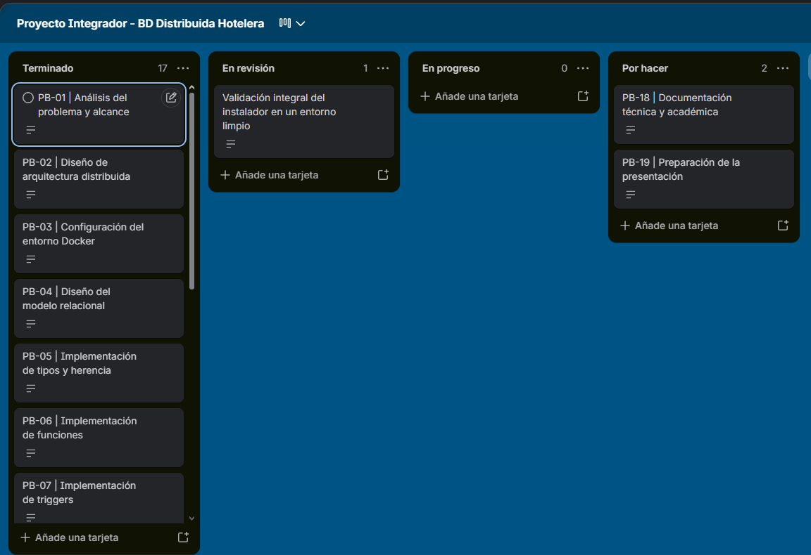
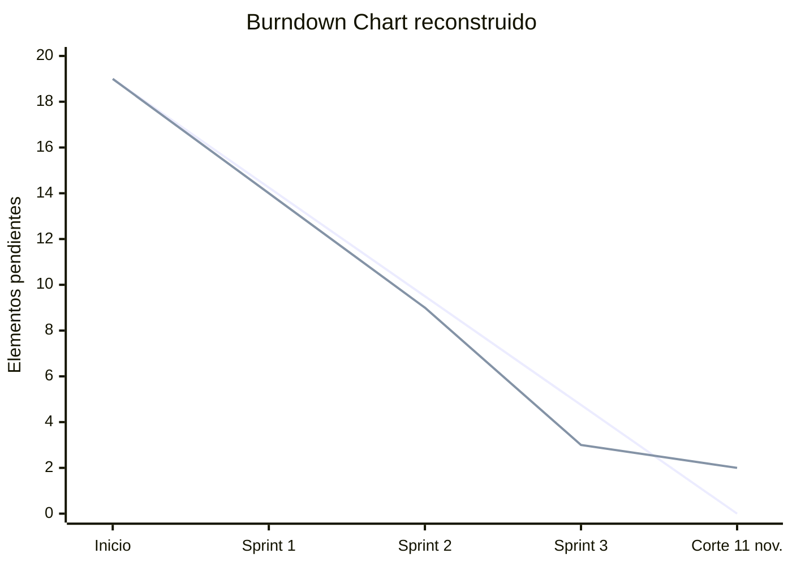

# 3. PLANIFICACIÓN DEL PROYECTO CON SCRUM

## 3.1 Metodología

Para organizar el desarrollo se adoptó un enfoque ágil basado en Scrum, utilizando iteraciones semanales para dividir el trabajo en objetivos pequeños y verificables. El proyecto se estructuró en cuatro sprints, considerando las actividades de análisis, diseño, implementación, integración, pruebas y documentación.

Debido a que la planificación se está documentando después de realizar una parte importante del desarrollo, los sprints y sus resultados representan una reconstrucción organizada de las actividades realizadas. No se presentan reuniones, métricas históricas o registros de seguimiento que no hayan sido documentados.

## 3.2 Roles del proyecto

| Rol Scrum        | Responsable                                                                              |
| ---------------- | ---------------------------------------------------------------------------------------- |
| Product Owner    | Alumno responsable del proyecto, encargado de definir las funcionalidades y prioridades. |
| Scrum Master     | Alumno responsable de organizar las actividades y dar seguimiento al desarrollo.         |
| Development Team | Alumno responsable del análisis, diseño, programación, pruebas e integración.            |

Al tratarse de un proyecto individual, una misma persona desempeña los diferentes roles.

## 3.3 Product Backlog

| ID    | Elemento del backlog               | Prioridad | Resultado esperado                       |
| ----- | ---------------------------------- | --------- | ---------------------------------------- |
| PB-01 | Análisis del problema y alcance    | Alta      | Definición del problema y objetivos.     |
| PB-02 | Diseño de arquitectura distribuida | Alta      | Arquitectura de cuatro nodos.            |
| PB-03 | Configuración del entorno Docker   | Alta      | Cuatro instancias PostgreSQL.            |
| PB-04 | Diseño del modelo relacional       | Alta      | Tablas y relaciones principales.         |
| PB-05 | Implementación de tipos y herencia | Media     | Características orientadas a objetos.    |
| PB-06 | Implementación de funciones        | Alta      | Operaciones de reservaciones.            |
| PB-07 | Implementación de triggers         | Alta      | Auditoría y cálculo de importes.         |
| PB-08 | Implementación de vistas e índices | Alta      | Consultas operativas y optimización.     |
| PB-09 | Pruebas de rendimiento             | Media     | Comparación de planes de ejecución.      |
| PB-10 | Pruebas de concurrencia            | Alta      | Prevención de reservaciones traslapadas. |
| PB-11 | Configuración de respaldo y WAL    | Alta      | Respaldo físico y archivado.             |
| PB-12 | Prueba de recuperación PITR        | Alta      | Recuperación a un punto temporal.        |
| PB-13 | Particionamiento central           | Alta      | Particiones por sede.                    |
| PB-14 | Replicación lógica                 | Alta      | Sincronización de las sedes con central. |
| PB-15 | Consultas distribuidas FDW         | Alta      | Acceso remoto a las tres sedes.          |
| PB-16 | Transacción distribuida 2PC        | Alta      | Traslado de reservación entre sedes.     |
| PB-17 | Cliente de demostración Python     | Media     | Interfaz de consola operativa.           |
| PB-18 | Documentación técnica y académica  | Alta      | Informe, manuales y referencias.         |
| PB-19 | Preparación de la presentación     | Alta      | Material para la defensa del proyecto.   |

## 3.4 Planificación de sprints

### Sprint 1. Análisis, arquitectura y estructura de datos

**Objetivo:** establecer la arquitectura del proyecto y construir la estructura inicial de las bases de datos.

Actividades:

- Analizar el problema de administración hotelera.
- Definir los objetivos y alcance.
- Diseñar la arquitectura con tres nodos operativos y uno central.
- Configurar Docker Compose.
- Crear los tipos compuestos.
- Crear las tablas principales y sus relaciones.
- Implementar herencia de tablas y estructuras complejas.

**Resultado:** infraestructura local con cuatro instancias PostgreSQL y estructura inicial de datos.

### Sprint 2. Operaciones, integridad y optimización

**Objetivo:** implementar las operaciones principales de reservaciones y los mecanismos de integridad.

Actividades:

- Crear funciones PL/pgSQL.
- Implementar check-in, check-out y cancelación.
- Crear triggers de auditoría.
- Implementar cálculo automático de totales.
- Crear vistas operativas.
- Crear índices B-tree, GiST y GIN.
- Generar datos de prueba para rendimiento.
- Comparar planes de ejecución.

**Resultado:** operaciones hoteleras funcionales, controles de integridad, auditoría y optimización de consultas.

### Sprint 3. Transacciones y distribución

**Objetivo:** implementar y comprobar los mecanismos de concurrencia, recuperación y distribución de información.

Actividades:

- Ejecutar pruebas de concurrencia.
- Configurar respaldo físico y archivado WAL.
- Realizar una recuperación PITR.
- Particionar las reservaciones del nodo central.
- Configurar publicaciones y suscripciones de replicación lógica.
- Configurar servidores y tablas externas mediante postgres_fdw.
- Implementar y probar el traslado de reservaciones mediante 2PC.

**Resultado:** arquitectura distribuida funcional y pruebas de integridad, replicación y recuperación.

### Sprint 4. Integración, cliente y documentación

**Objetivo:** integrar el cliente Python con los tres nodos operativos, verificar las funcionalidades principales y completar la documentación y los entregables académicos del proyecto.

**Periodo:** 4 al 11 de noviembre de 2026.

**Actividades y estado:**

| Actividad                                                 | Estado      |
| --------------------------------------------------------- | ----------- |
| Desarrollar el cliente de consola en Python.              | Terminado   |
| Integrar las operaciones de las tres sedes.               | Terminado   |
| Implementar reportes consolidados.                        | Terminado   |
| Probar consultas de disponibilidad y reservaciones.       | Terminado   |
| Verificar check-in, check-out y cancelación.              | Terminado   |
| Revisar los scripts de instalación para entornos limpios. | Terminado   |
| Actualizar README y documentación técnica.                | Terminado   |
| Preparar evidencias de ejecución.                         | Terminado   |
| Integrar el informe académico en un único PDF.            | Terminado   |
| Preparar la presentación final para la defensa.           | Terminado   |

**Resultado:** se cuenta con un cliente Python integrado, operaciones principales verificadas, documentación técnica actualizada y evidencias de ejecución. El instalador se validó de principio a fin en un entorno limpio aislado, el informe académico se integró en un PDF único y la presentación final quedó preparada.

## 3.5 Seguimiento y control

Para representar el estado de las actividades del proyecto se utilizó un tablero Kanban con los siguientes estados:

- Por hacer.
- En progreso.
- En revisión.
- Terminado.

El tablero presentado constituye una reconstrucción retrospectiva de la organización y el avance de las actividades. Su contenido se organizó tomando como referencia las funcionalidades implementadas, las pruebas realizadas, los archivos del proyecto y los resultados obtenidos. Por lo tanto, no debe interpretarse como un registro histórico de movimientos realizados diariamente durante el desarrollo.

Los estados asignados representan la situación de las actividades al momento de elaborar esta documentación. El historial de Git se utiliza como evidencia complementaria para consultar modificaciones y commits relacionados con el desarrollo, pero no como registro de los movimientos del tablero Kanban.

### Evidencia del tablero Kanban

La Figura 1 muestra el tablero Kanban elaborado para representar el estado de las actividades del proyecto al 11 de noviembre de 2026. Se incluyen las actividades terminadas, pendientes y en revisión, de acuerdo con el avance documentado del proyecto.

_Figura 1. Tablero Kanban del proyecto integrador de base de datos distribuida._

## 3.6 Seguimiento de avance

No se cuenta con registros históricos de puntos de historia, horas estimadas por tarea o mediciones diarias de trabajo. Por esta razón, no se presenta un burndown chart histórico como si hubiera sido generado durante cada sprint.

Para un seguimiento verificable se propone registrar en cada sprint:

| Indicador          | Forma de medición                                         |
| ------------------ | --------------------------------------------------------- |
| Trabajo pendiente  | Elementos del backlog todavía no terminados.              |
| Trabajo completado | Elementos aceptados y verificados.                        |
| Incidencias        | Errores encontrados durante implementación y pruebas.     |
| Avance del sprint  | Elementos completados respecto al total comprometido.     |
| Cambios            | Modificaciones realizadas al alcance o a las prioridades. |

El porcentaje de avance se calcula mediante:

**Avance (%) = (Elementos completados / Elementos comprometidos) × 100**

### 3.6.1 Burndown Chart

Debido a que no se registraron mediciones diarias durante el desarrollo, se presenta una reconstrucción retrospectiva del avance utilizando como unidad de medida los 19 elementos del Product Backlog. El gráfico compara el trabajo pendiente ideal con el avance reconstruido al cierre de cada sprint y al corte del 11 de noviembre de 2026.

Para esta reconstrucción, los elementos se distribuyeron de la siguiente manera:

- Sprint 1: PB-01 a PB-05 (5 elementos).
- Sprint 2: PB-06 a PB-10 (5 elementos).
- Sprint 3: PB-11 a PB-16 (6 elementos).
- Sprint 4: PB-17 a PB-19 (3 elementos).

Al corte del 11 de noviembre se consideraban completados 17 elementos. Los dos entregables documentales restantes se concluyeron el 13 de noviembre, por lo que el backlog quedó completo.

| Etapa                | Trabajo ideal pendiente | Trabajo reconstruido pendiente |
| -------------------- | ----------------------: | -----------------------------: |
| Inicio               |                      19 |                             19 |
| Cierre Sprint 1      |                   14.25 |                             14 |
| Cierre Sprint 2      |                    9.50 |                              9 |
| Cierre Sprint 3      |                    4.75 |                              3 |
| Corte del 11/11/2026 |                       0 |                              2 |

La línea ideal representa una reducción uniforme del trabajo pendiente. La línea reconstruida representa el avance estimado mediante los elementos del backlog, no mediciones históricas tomadas durante la ejecución.

**Interpretación:** el desarrollo técnico y las pruebas principales se completaron antes de la integración de los entregables académicos. Al corte del 11 de noviembre quedaban dos elementos documentales; ambos se concluyeron el 13 de noviembre con la integración del PDF y la preparación de la presentación.

**Leyenda:**

- Primera línea: trabajo ideal pendiente.
- Segunda línea: trabajo reconstruido pendiente.

## 3.7 Retrospectivas

Las siguientes retrospectivas son una evaluación retrospectiva del desarrollo, no actas de reuniones celebradas durante los sprints.

**Sprint 1**

- Aspectos positivos: se estableció una arquitectura clara y se separaron las bases de datos por sede.
- Dificultades: fue necesario considerar las particularidades de PostgreSQL, especialmente en herencia y restricciones.
- Mejora: validar los scripts desde el principio y mantener un orden de instalación.

**Sprint 2**

- Aspectos positivos: se centralizó la lógica de reservaciones en funciones y se automatizaron cálculos mediante triggers.
- Dificultades: fue necesario ajustar índices y restricciones para mantener integridad y compatibilidad.
- Mejora: probar cada función y trigger de forma aislada antes de integrarlos.

**Sprint 3**

- Aspectos positivos: se logró configurar replicación lógica, consultas distribuidas y recuperación PITR.
- Dificultades: la replicación requirió identidades adecuadas para las tablas y el traslado 2PC necesitó coordinación explícita.
- Mejora: verificar la configuración de cada nodo y registrar resultados de cada operación.

**Sprint 4**

- Aspectos positivos: se integró un cliente Python y se actualizaron los archivos de instalación y documentación.
- Dificultades: el producto técnico avanzó antes que la documentación académica.
- Mejora: reservar tiempo específico para evidencias, manuales y preparación de la defensa.

## 3.8 Conclusión de la planificación

La organización por sprints permitió dividir el proyecto en etapas relacionadas con las competencias de la asignatura. La reconstrucción del backlog facilita identificar las funcionalidades desarrolladas, sus dependencias y los resultados que deben demostrarse. Al 13 de noviembre de 2026, el producto, las evidencias técnicas, el informe integrado en PDF y la presentación para la defensa están elaborados. La instalación limpia se validó en un entorno aislado y el entorno original permaneció intacto.
