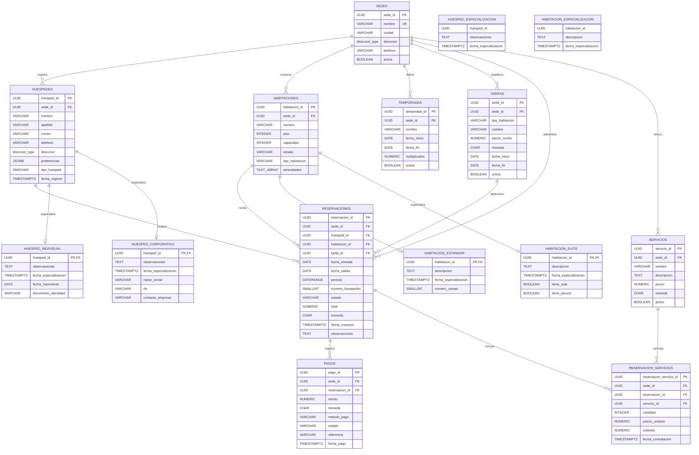

# Diagrama entidad-relación

## Base de datos distribuida para reservaciones de una cadena hotelera

El siguiente diagrama representa las entidades principales del sistema, sus atributos y las relaciones implementadas mediante claves primarias y foráneas en PostgreSQL.

## Consideraciones del modelo

1. Cada sede administra sus propios huéspedes, habitaciones, temporadas, tarifas, reservaciones y servicios.
2. Una reservación pertenece a un huésped, una habitación y una tarifa de la misma sede. Esta condición se garantiza mediante claves foráneas compuestas.
3. Una reservación puede tener varios pagos y contratar varios servicios.
4. La tabla `reservacion_servicios` resuelve la relación muchos a muchos entre reservaciones y servicios.
5. Las tablas `huesped_individual`, `huesped_corporativo`, `habitacion_estandar` y `habitacion_suite` utilizan herencia nativa de PostgreSQL mediante `INHERITS`.
6. Las tarifas y temporadas son entidades independientes en la implementación actual; no existe una clave foránea directa entre ambas.
7. El campo `periodo` se genera a partir de las fechas de entrada y salida para controlar los traslapes de reservaciones.

**Nota:** Las relaciones de especialización representan las claves foráneas existentes hacia las tablas principales. La herencia nativa de PostgreSQL es una característica adicional del modelo y no equivale a una relación de clave foránea con las tablas de especialización.
