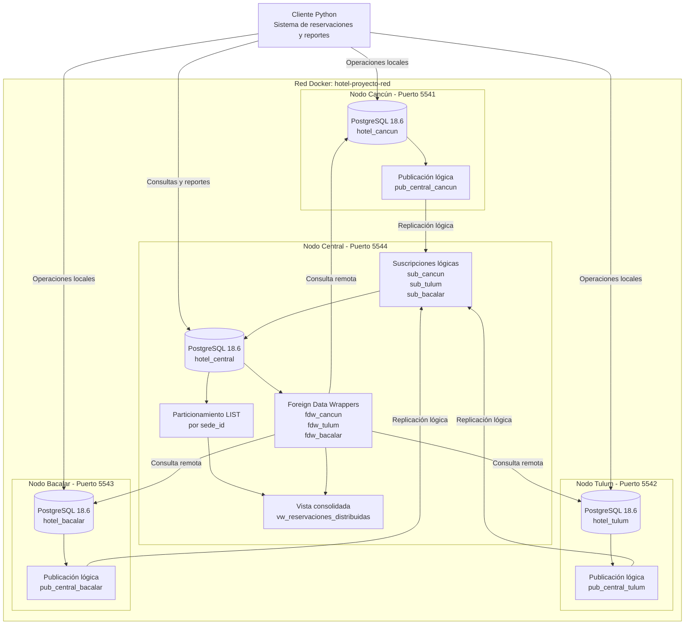

# Diagrama de arquitectura distribuida

## Base de datos distribuida para reservaciones de una cadena hotelera

El sistema utiliza cuatro instancias independientes de PostgreSQL 18.6 desplegadas mediante Docker. Cada sede administra sus operaciones localmente y envía información al nodo central mediante replicación lógica. El nodo central también consulta las bases de las sedes mediante PostgreSQL Foreign Data Wrapper (FDW).

## Componentes de la arquitectura

| Componente            | Función                                                                       |
| --------------------- | ----------------------------------------------------------------------------- |
| Nodo Cancún           | Administra las reservaciones y operaciones de la sede Cancún.                 |
| Nodo Tulum            | Administra las reservaciones y operaciones de la sede Tulum.                  |
| Nodo Bacalar          | Administra las reservaciones y operaciones de la sede Bacalar.                |
| Nodo Central          | Recibe la replicación lógica y consolida información de las sedes.            |
| Replicación lógica    | Transfiere cambios de las tablas publicadas hacia el nodo central.            |
| Particionamiento LIST | Organiza las reservaciones centrales de acuerdo con el identificador de sede. |
| PostgreSQL FDW        | Permite consultar tablas remotas de las tres sedes.                           |
| Cliente Python        | Permite realizar operaciones locales y consultar reportes consolidados.       |

## Consideraciones técnicas

- Cada instancia PostgreSQL funciona como un nodo independiente.
- Las sedes realizan operaciones directamente sobre sus respectivas bases de datos.
- La replicación lógica transmite los cambios de las tablas publicadas al nodo central.
- El nodo central utiliza particionamiento LIST para organizar las reservaciones por sede.
- FDW permite consultar información remota sin copiarla mediante una consulta convencional.
- El traslado de reservaciones entre sedes se realiza mediante transacciones preparadas y coordinación desde Python (2PC).
- La recuperación PITR fue configurada y probada únicamente en el nodo Cancún.

**Nota:** La arquitectura implementada es una solución académica distribuida. No cuenta con alta disponibilidad ni recuperación automática ante fallos.
